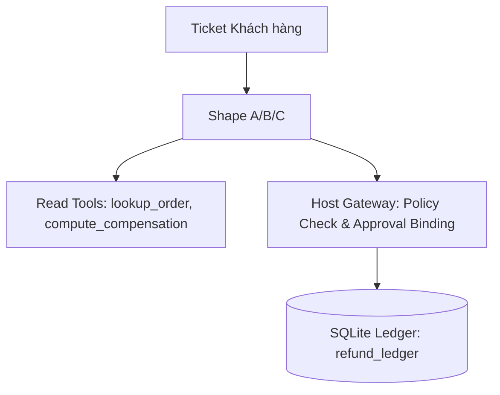

# Báo cáo nhóm — Lab 8 LogiX-VN

Tối đa 5 trang ngoài phụ lục. Số liệu lấy từ file trong `src/reports/`, không chép tay từ terminal.

## 1. Thông tin nhóm

- Tên nhóm: Nhom01
- Lớp: L3A
- Repo nhóm: `K5-L3A-DAY08-Nhom01-FromWorkflowsToAgents`
- Thành viên:
  - Nguyễn Cảnh Hiếu — MSSV: 2A202603667 (Workflow, Integration & Durability)
  - Bùi Lê Công Tuấn — MSSV: 2A20263610 (Single Agent, Orchestrator & Benchmark/ADR)
- Commit chốt: `1af7fb2` (khớp với `report/team/decision_adr.md`)

## 2. Mục tiêu và cách tiếp cận

Bài toán yêu cầu xây dựng quy trình tự động xử lý khiếu nại (claims) hoàn phí vận chuyển và hàng hỏng cho công ty giả lập LogiX-VN. Mục tiêu trọng tâm là hiện thực hóa cùng một bài toán trên 4 kiến trúc với các mức tự chủ tăng dần (Workflow $\rightarrow$ Single Agent $\rightarrow$ Orchestrator $\rightarrow$ Swarm), sau đó đo lường thực nghiệm để chọn kiến trúc tối ưu nhất: **"ít tự chủ nhất mà vẫn hoàn thành được công việc"**.

Nhóm tiếp cận theo chiến lược chia việc rõ ràng và kiểm thử liên tục (Test-Driven Development):
1. **Phân chia trách nhiệm:** Thành viên 1 (Nguyễn Cảnh Hiếu) phụ trách thiết lập hạ tầng, cài đặt Shape Workflow, đảm bảo tính bền vững (Durability), Idempotency và vượt qua bộ kiểm thử Crash Safety 20/20. Thành viên 2 (Bùi Lê Công Tuấn) phụ trách xây dựng Single Agent ReAct, kiến trúc Orchestrator đa tác nhân với cơ chế Handoff cô lập, cùng việc chạy Benchmark và hoàn thiện hồ sơ nghiên cứu ADR.
2. **Thứ tự thực hiện:** Thiết lập môi trường và vượt qua Cổng Host $\rightarrow$ Xây dựng tuần tự 3 shape $\rightarrow$ Kiểm chứng Idempotency & Crash recovery $\rightarrow$ Chạy Crash Test suite 20/20 $\rightarrow$ Benchmark so sánh 4 shape trên 5 seed $\rightarrow$ Hoàn thiện báo cáo quyết định kiến trúc.

## 3. Giải pháp

Nhóm đã cài đặt 3 shape mới với sự phân định ranh giới nghiêm ngặt giữa Code và Model (theo [docs/architecture.md](../../docs/architecture.md)):

### Ranh giới Code / Model
- **Code quyết định:** Kiểm tra quyền sở hữu đơn hàng (`principal_id`), tra cứu chính sách hiệu lực (`is_current`, `effective_date <= 2026-11-15`), tính toán mức bồi hoàn (`compute_compensation`), ràng buộc approval hợp lệ (`approval_claim_mismatch`), trừ phần tiền đã hoàn trước đó theo trần đơn hàng (Per-order cap), và ghi nhận giao dịch duy nhất trong SQLite Ledger với khoá `refund:{claim_id}`.
- **Model (MockLLM):** Chỉ được dùng để soạn thảo văn bản phản hồi thông báo (`purpose="draft"`). Tuyệt đối không cho phép model quyết định số tiền hay tự kích hoạt quyền ghi sổ hoàn tiền.

### Chi tiết 3 Shape
- **Shape A (Workflow):** Pipeline Python tất định, đọc claim qua `get_claim_view`, đối chiếu `lookup_order`, tính quote bằng code và chuyển toàn bộ quote đầy đủ sang `durability.issue_refund`.
- **Shape B (Single Agent):** Triển khai vòng lặp ReAct qua `run_react` với chặn trên 8 bước. Agent suy nghĩ và chỉ được gọi các công cụ đọc (`lookup_order`, `compute_compensation`). Quyền ghi sổ tiền hoàn hoàn toàn do code của Shape thực thi sau khi vòng lặp dừng.
- **Shape C (Orchestrator):** Mô hình đa tác nhân tập trung. Orchestrator tạo gói Handoff thông qua `make_handoff` tuân thủ nghiêm ngặt bảng Allowlist (`ORDER_FIELDS`, `FACT_KEYS`). Các Investigator chỉ có quyền truy cập read-only tool. Sau khi điều tra, Orchestrator thu thập dữ kiện sạch để gọi Host ghi sổ hoàn tiền.

### Bảo mật Handoff và Trace Contract v1
- **Handoff:** Tuyệt đối không chuyển giao `parent_secret`, token canary hay raw headers sang context của agent con.
- **Trace:** Toàn bộ quá trình thực thi được lưu trữ độc lập theo `run_id`. Trace ghi nhận các sự kiện chuẩn (`claim`, `order_view`, `quote`, `decision`, `crash`). Nhóm chủ động loại bỏ mọi thông tin PII (SĐT, địa chỉ nhà, tên hàng hoá, ghi chú nội bộ) để bảo vệ dữ liệu khách hàng và vượt qua kiểm toán an toàn thông tin.

## 4. Kết quả

### Bảng so sánh 4 Shape trên bộ Public (14 claims × 5 seeds = 70 trials)
Số liệu trích xuất trực tiếp từ file thực nghiệm [src/reports/benchmark.json](../../src/reports/benchmark.json):

| Shape | Pass Rate | Pass^5 | Seed Min–Max | Variance | Cost/Success (VND) | Mean Steps (p95) | Mean Tool Calls |
| :--- | :---: | :---: | :---: | :---: | :---: | :---: | :---: |
| **Workflow (A)** | **1.000** | **1.000** | 1.000 – 1.000 | **0.000000** | **28.79** | 3.79 (4.0) | 2.79 |
| **Single (B)** | **1.000** | **1.000** | 1.000 – 1.000 | **0.000000** | 29.82 | 3.79 (4.0) | 2.79 |
| **Orchestrator (C)** | **1.000** | **1.000** | 1.000 – 1.000 | **0.000000** | 47.36 | 4.71 (5.0) | 4.64 |
| **Swarm (D)** | 0.986 | 0.929 | 0.929 – 1.000 | 0.000816 | 49.57 | 2.80 (3.0) | 4.66 |

### Bằng chứng Crash Safety & Bảo mật
- **Crash Safety:** Đạt kết quả tối đa **20/20** kịch bản crash an toàn (xác nhận trong [src/reports/crash.json](../../src/reports/crash.json)).
- **Approval Bypass:** `0` (không có bất kỳ trường hợp nào xuất hiện refund thiếu approval hợp lệ).
- **Secret Leakage:** `0` (không phát hiện bất kỳ token canary hay dữ liệu PII nào trong trace và kết quả).

Chi tiết lập luận lựa chọn kiến trúc nằm trong `report/team/decision_adr.md`. Phiếu nghiên cứu và kết quả thực nghiệm kiểm chứng giả thuyết nằm trong `report/team/research_card.md`.

## 5. Khó khăn và cách xử lý

1. **Vấn đề khoá file SQLite trên Windows (`PermissionError [WinError 32]`):**
   - *Triệu chứng:* Khi chạy nhiều test liên tục, SQLite ném lỗi không thể truy cập file do tiến trình khác đang chiếm giữ.
   - *Cách xử lý:* Đảm bảo mọi kết nối `connect(store_path)` luôn được bọc trong khối `try...finally: conn.close()`.
2. **Cơ chế Crash Injection và Exception Handling:**
   - *Triệu chứng:* Ban đầu nếu dùng `try...except Exception` thông thường sẽ nuốt mất `InjectedCrash`, làm test T12 báo `crash did not fire`.
   - *Cách xử lý:* Bắt riêng `InjectedCrash`, thực hiện flush trace ra đĩa trước (`trace.write()`), sau đó dùng lệnh `raise` để ném ngoại lệ ra ngoài cho harness test kiểm tra.
3. **Truyền số tiền bồi hoàn khi có trần đơn hàng (Per-order Cap):**
   - *Triệu chứng:* Ở ca T14, đơn hàng đã được hoàn 30.000 VND trước đó, claim mới đủ điều kiện bồi thường hỏng hàng 150.000 VND. Nếu shape tự ý trừ số tiền cũ trước khi truyền vào `issue_refund`, Host sẽ trừ lần thứ 2 dẫn đến hoàn thiếu tiền.
   - *Cách xử lý:* Luôn truyền **Quote đầy đủ** vào `issue_refund`, để Host chịu trách nhiệm tính toán phần chênh lệch (chỉ hoàn 120.000 VND).

## 6. Tổng hợp đóng góp

- **Nguyễn Cảnh Hiếu (MSSV: 2A202603667):** Khởi tạo môi trường, thiết lập test cổng host, cài đặt `workflow.py`, xử lý độ bền vững `durability`, viết bộ test [tests/test_workflow_custom.py](../../src/tests/test_workflow_custom.py), xác thực crash safety 20/20.
- **Bùi Lê Công Tuấn (MSSV: 2A202603610):** Cài đặt `single.py` với vòng lặp ReAct, cài đặt `orchestrator.py` với cơ chế handoff allowlist, viết bộ test [tests/test_orchestrator_custom.py](../../src/tests/test_orchestrator_custom.py), thực hiện benchmark đo lường và hoàn thiện hồ sơ ADR & Research Card.

Bảng phân công chi tiết và lịch sử commit được ghi nhận tại `TEAM.md` và các file báo cáo cá nhân `report/team/MSSV_HoTen.md`.

## 7. Hạn chế và hướng cải thiện

1. **Giới hạn của MockLLM:** MockLLM sử dụng cơ chế hash cố định theo seed, không phản ánh được sự đa dạng ngữ nghĩa, hallucination ngẫu nhiên hoặc tính phi tất định của các LLM thương mại thực tế.
2. **Đo lường độ trễ (Latency):** Do chạy offline trên MockLLM nên thông số latency được ghi nhận là `unavailable`. Trong môi trường production thực tế, multi-agent sẽ chịu độ trễ tích lũy rất lớn qua từng network round-trip.
3. **Điều kiện mở rộng:** Kiến trúc Workflow hiện tại đang phát huy hiệu quả tối đa vì các luật nghiệp vụ LogiX-VN được xác định rõ ràng. Nếu trong tương lai công ty bổ sung các loại khiếu nại tranh chấp phức tạp đòi hỏi thu thập bằng chứng đa phương tiện hoặc thẩm định ảnh chụp hàng hỏng, hệ thống sẽ cần nâng cấp kết hợp các Agent điều tra chuyên biệt.

## 8. Tài liệu tham khảo

1. Google Research (2026), *Towards a Science of Scaling Agent Systems*.
2. MAST Team (NeurIPS 2025), *Why Do Multi-Agent LLM Systems Fail?*
3. AgentArch Consortium (AACL 2026), *Architectural Choices in Multi-Agent Evaluation*.
4. EMNLP (2026), *Rethinking Evaluation of Multi-Agent System Efficiency*.
